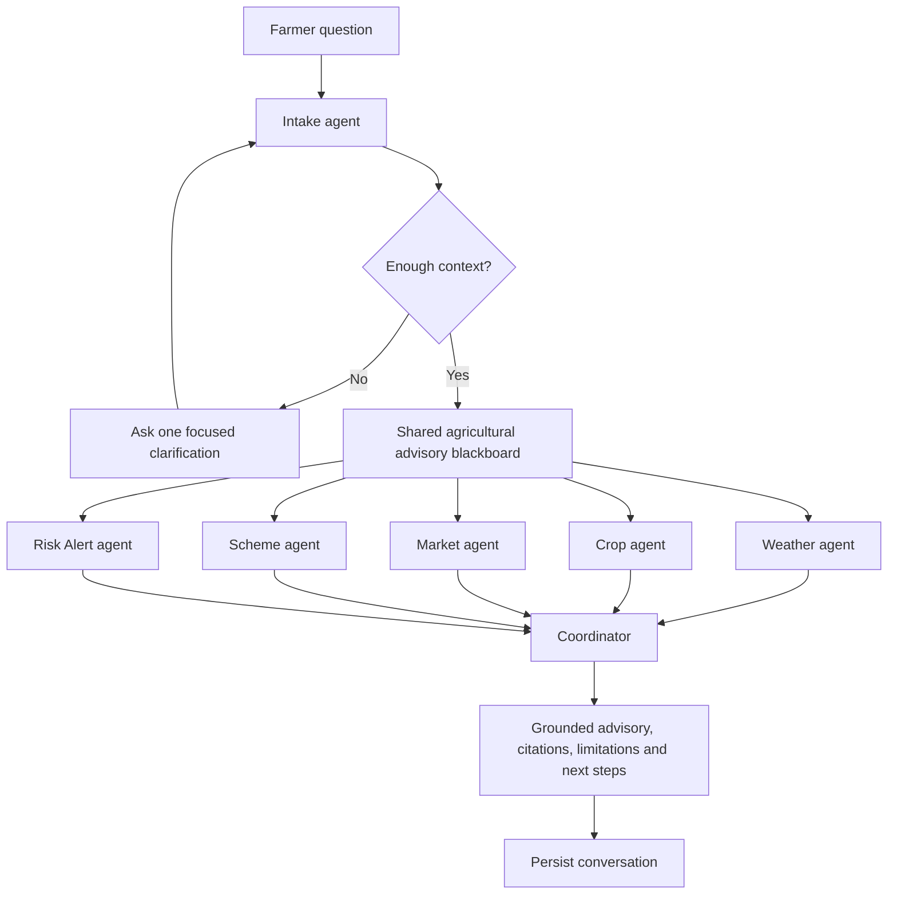

# AgroSage — Intelligence for Every Acre

AgroSage is a local-first, conversational agricultural advisory application. A farmer can describe a crop problem in ordinary language; AgroSage gathers the context it needs, asks short follow-up questions when necessary, and coordinates specialist agents to assemble an evidence-aware response about crop health, weather, market information, government schemes, and agricultural risks.

The system is designed to communicate uncertainty. A farmer-reported symptom is not treated as a confirmed diagnosis, a general scheme summary is not treated as a personal eligibility decision, and missing regional evidence is disclosed rather than invented.

Repository: [BGaganKumarreddy/Agrosage](https://github.com/BGaganKumarreddy/Agrosage)<br>
Product tagline: **Intelligence for Every Acre.**

---

## Contents

- [What AgroSage does](#what-agrosage-does)
- [How the system works](#how-the-system-works)
- [The seven agents](#the-seven-agents)
- [Evidence and external data](#evidence-and-external-data)
- [Technology stack](#technology-stack)
- [Run locally](#run-locally)
- [Configure an LLM provider](#configure-an-llm-provider)
- [Testing](#testing)
- [Security and privacy](#security-and-privacy)
- [Known limitations](#known-limitations)
- [Project structure](#project-structure)
- [Project documentation](#project-documentation)

---

## What AgroSage does

- **Conversational agricultural assistance**: Farmers can describe a question in their own words and continue the discussion in the same conversation.
- **Progressive clarification**: Intake identifies missing context and asks a focused follow-up question instead of forcing the farmer to complete a technical form.
- **Seven-agent workflow**: Specialist agents handle weather, crop, market, schemes, and risk; a Coordinator combines the available validated findings.
- **Retrieval-augmented generation (RAG)**: Crop and scheme responses can use curated agricultural and official scheme documents with traceable evidence references.
- **Farm profile and context**: A saved farm profile can provide defaults such as location and crop context. A conversation-specific correction or override does not silently rewrite the saved profile.
- **Live information where available**: Weather observations/forecasts and mandi prices can be retrieved from configured external sources.
- **Partial-result handling**: If a provider or specialist is unavailable, AgroSage can retain valid results from other specialists and disclose what could not be retrieved.
- **Local-first operation**: The backend, frontend, and SQLite persistence run locally. Live LLM inference is optional and requires a user-configured provider credential.

---

## How the system works



The React frontend communicates with a FastAPI backend. The backend owns authentication, farm-profile and conversation persistence, context handling, retrieval, agent orchestration, and response assembly. Specialist findings and evidence are shared through an agricultural advisory blackboard. The Coordinator synthesizes the available validated results; it must not invent missing evidence.

---

## The seven agents

| Agent | Responsibility |
|---|---|
| **Intake** | Understands the farmer's request, extracts known crop/location/stage/intent context, and asks for essential missing information. |
| **Weather** | Retrieves available weather observations and forecasts relevant to the supplied location and advisory. |
| **Crop** | Retrieves applicable crop knowledge and prepares evidence-aware agronomic guidance. |
| **Market** | Retrieves available mandi observations, including market, commodity, grade/variety, price, and observation date where provided. |
| **Scheme** | Retrieves government-scheme guidance and explains source-stated requirements without declaring personal eligibility. |
| **Risk Alert** | Identifies potential weather, crop-health, and other supported risks from available evidence and context. |
| **Coordinator** | Combines validated specialist outputs, filters citations against available evidence, and provides a coherent advisory or deterministic fallback. |

Agent outcomes are not all-or-nothing. An agent may complete, return a partial result, be skipped because it is not relevant or lacks required context, or become unavailable when a provider/data source fails. The interface exposes execution status so a partial advisory is not mistaken for a complete one.

---

## Evidence and external data

AgroSage combines curated documents with external data sources where configured and available.

| Information area | Sources represented in the project | Important qualification |
|---|---|---|
| **Crop practices and crop-health context** | ICAR material and Punjab Agricultural University (PAU) agricultural publications | Applicability depends on crop, geography, growth stage, and the retrieved document. A symptom description alone is not a diagnosis. |
| **Government schemes** | Official scheme documents, including PM-KISAN and PMFBY guidance | Scheme rules, notified areas/crops, deadlines, and required documents can change. Confirm current conditions with the issuing authority. |
| **Weather** | Open-Meteo | Results are location- and timestamp-dependent; availability and forecast coverage may vary. |
| **Mandi market information** | AGMARKNET / data.gov.in | A quotation is an observation for a particular market, commodity, grade/variety, and date—not a guaranteed sale price or a trend forecast. |

The retrieval pipeline preserves evidence identity and applicability metadata. It progressively broadens retrieval when a highly specific crop/location/stage match is unavailable, while keeping the crop identity fixed. If suitable evidence still cannot be found, the system should return a limitation instead of fabricating a source or recommendation.

---

## Technology stack

### Backend
- Python and Pydantic
- Microsoft Agent Framework for multi-agent orchestration
- FastAPI and Uvicorn
- SQLite persistence
- Retrieval and embeddings using FastEmbed, with a replaceable embedding interface
- Provider-neutral inference adapters for Cerebras, Groq, and Google Gemini, plus deterministic execution for repeatable local evaluation
- Argon2id password hashing and AES-256-GCM credential encryption

### Frontend
- React 19 and Vite
- Tailwind CSS v4
- React Router
- Axios
- Lucide icons
- Vitest and React Testing Library

---

## Run locally

The documented local workflow below targets Windows 10/11 with PowerShell. The persistent Windows credential-key adapter uses Windows DPAPI; see [Known limitations](#known-limitations) before attempting to run the credential vault on another operating system.

### Prerequisites
- Git
- Python 3.12 or a compatible version accepted by the project dependencies
- [uv](https://docs.astral.sh/uv/)
- Node.js and npm

### 1. Clone the repository
```bash
git clone https://github.com/BGaganKumarreddy/Agrosage.git
cd Agrosage
```

### 2. Install backend dependencies
```bash
uv sync
```

### 3. Install frontend dependencies
```bash
cd frontend
npm install
cd ..
```

The frontend example configuration is in `frontend/.env.example`. For a local override, copy it to `frontend/.env.local` and keep the API base URL pointed at the local backend:
```powershell
Copy-Item frontend/.env.example frontend/.env.local
```

The example API base URL is:
```text
http://127.0.0.1:8000/api/v1
```

> **Note**: Do not put provider API keys in frontend environment files.

### 4. Start the backend
Open a terminal at the repository root:
```powershell
uv run uvicorn rythusaathi.api.app:app --reload --host 127.0.0.1 --port 8000
```

The backend endpoints are available at:
- **API base**: `http://127.0.0.1:8000/api/v1`
- **Swagger UI**: `http://127.0.0.1:8000/docs`
- **ReDoc**: `http://127.0.0.1:8000/redoc`

### 5. Start the frontend
Open a second terminal:
```powershell
cd frontend
npm run dev
```

Open the Vite URL printed in the terminal (the usual local address is `http://localhost:5173`). Register a local account or sign in, then configure the farm profile and start a conversation.

---

## Configure an LLM provider

AgroSage supports a Bring Your Own Key (BYOK) model. Live inference through Cerebras, Groq, or Google Gemini requires a valid provider credential enrolled for the local user, as well as provider availability and remaining quota.

1. Start the application and sign in.
2. Open the credential management page in the application.
3. Add the API key for the provider you intend to use.
4. Select that provider/mode for an advisory.

Credentials are encrypted at rest using AES-256-GCM. On Windows, the key-encryption key is protected using the Windows DPAPI-backed credential store. Raw provider keys should not be placed in source files, `.env` files, screenshots, issue reports, or terminal transcripts.

For repeatable local evaluation without an external LLM request, use the deterministic execution mode where available. Deterministic mode is useful for testing workflow integration; it is not a substitute for validating live provider behaviour. Live provider calls can be delayed, rate-limited, unavailable, or return malformed output. AgroSage uses bounded recovery and partial-result handling, but a live response is not guaranteed for every request.

---

## Testing

Run the backend test suite from the repository root:
```powershell
uv run python -m pytest -q
```

Run the frontend test suite:
```powershell
npm test --prefix frontend -- --run
```

Build the frontend for production:
```powershell
npm run build --prefix frontend
```

Check tracked changes for whitespace errors:
```powershell
git diff --check
```

### Verification snapshot

The repository audit dated 14 November 2026 independently reported the following results for the audited working tree:

| Check | Result |
|---|---|
| **Backend Pytest** | 588 passed, plus 87 subtests; exit code 0 |
| **Frontend Vitest** | 85 passed across 10 test files; exit code 0 |
| **Vite production build** | Successful; exit code 0 |
| **`git diff --check`** | No whitespace errors; exit code 0 |
| **Stage 6 browser farmer journey** | 15 of 15 steps reported passed |

*These are dated audit results, not a guarantee that future changes or every machine/provider configuration will produce identical results. Re-run the commands above against the checkout you intend to submit.*

---

## Security and privacy

- User passwords are hashed with Argon2id.
- Protected API resources use user/tenant ownership checks.
- BYOK provider credentials are encrypted at rest with AES-256-GCM; Windows key protection uses DPAPI.
- Application diagnostics and error paths include secret-redaction controls.
- Local application state is persisted in SQLite; local runtime databases and temporary files should remain untracked.
- When live inference is enabled, the relevant prompt/context is sent to the selected external LLM provider. Review that provider's data handling terms before using real farmer or personally identifying information.
- `sessionStorage` is used for browser session state in the audited frontend. It is not an XSS security boundary: JavaScript executing in the page can access it. Keep dependencies updated and do not treat browser storage choice as a replacement for secure application design.

---

## Known limitations

- **Geographic coverage is bounded**: The crop/location registry does not validate every Indian state, district, and crop combination. A RAG document may still be relevant when a specific registry pair is not validated; the application should disclose that distinction.
- **Agricultural knowledge is not a field diagnosis**: Photos, symptoms, and weather context may be insufficient to identify a disease or pest. Confirm serious crop-health decisions with a local KVK or qualified agriculture officer.
- **Scheme guidance can become outdated**: Some ingested scheme documents are historical. Confirm current notifications, enrollment windows, and eligibility with the official issuing authority.
- **Market data is observational**: A single mandi quotation does not establish a price trend or predict the farmer's realized sale price.
- **Live provider execution depends on external services**: Rate limits, outages, malformed model output, and credential configuration can cause partial results or deterministic fallback.
- **Windows credential protection is the primary local path**: The DPAPI-backed persistent key adapter is Windows-specific; other operating systems require a compatible credential-store configuration and should not be assumed to have equivalent support.
- **Local-first is not production hosting**: This repository is prepared for local academic demonstration and evaluation; it is not a claim of a hardened, horizontally scalable cloud deployment.

---

## Project structure

```text
agrosage/
├── data/                 # Curated agricultural and scheme knowledge
├── docs/                 # API handover, implementation and acceptance reports
│   ├── FRONTEND_API_HANDOVER.md
│   ├── STAGE_6_FINAL_LOCAL_ACCEPTANCE_REPORT.md
│   └── FINAL_REPOSITORY_AUDIT_REPORT.md
├── frontend/             # React/Vite application
│   ├── src/components/   # Layout, chat, UI and advisory components
│   ├── src/features/     # Workspace features
│   ├── src/pages/        # Application pages
│   ├── src/services/     # Backend API clients
│   └── src/test/         # Frontend tests
├── scripts/              # CLI, ingestion and evaluation utilities
├── src/rythusaathi/      # Backend package (internal namespace retained)
│   ├── agents/           # Seven agents and workflow orchestration
│   ├── api/              # FastAPI app, routes and schemas
│   ├── inference/        # Provider-neutral inference contracts/adapters
│   ├── knowledge/        # Document processing and retrieval
│   └── security.py       # Security and redaction utilities
└── tests/                # Backend unit, integration and reliability tests
```

*The internal Python package remains named `rythusaathi` for compatibility. The user-facing product name is AgroSage.*

---

## Project documentation

- [`docs/FRONTEND_API_HANDOVER.md`](docs/FRONTEND_API_HANDOVER.md) — API contracts and frontend integration reference.
- [`docs/STAGE_6_FINAL_LOCAL_ACCEPTANCE_REPORT.md`](docs/STAGE_6_FINAL_LOCAL_ACCEPTANCE_REPORT.md) — final local farmer-journey acceptance evidence.
- [`docs/FINAL_REPOSITORY_AUDIT_REPORT.md`](docs/FINAL_REPOSITORY_AUDIT_REPORT.md) — repository audit, findings, and submission-readiness assessment.
- Other files under [`docs/`](docs/) contain implementation history, phase reports, and supporting evidence.

---

**AgroSage — Intelligence for Every Acre.**
