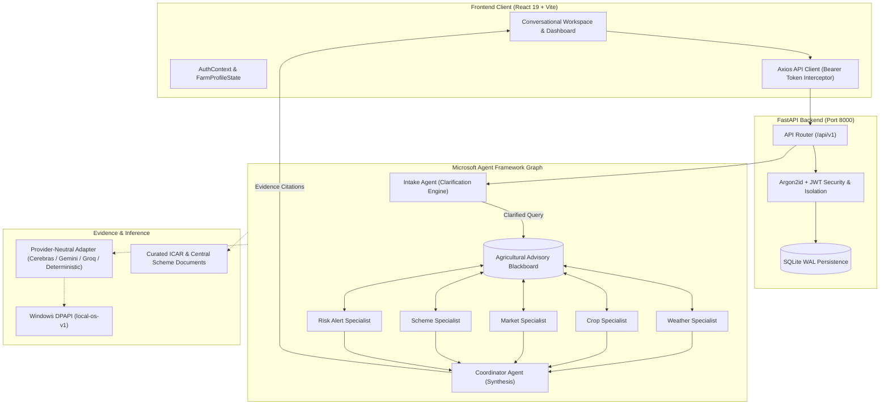

# AgroSage — Final Repository Audit and Submission Readiness Assessment Report

**Product Name:** AgroSage
**Tagline:** Intelligence for Every Acre.
**Repository:** `BGaganKumarreddy/agrosage`
**Current Branch:** `main`
**HEAD Commit:** `79554db3b346ab12b31411b44968368e849d966f` (`Docs: improve AgroSage README accuracy`)
**Internal Package Namespace:** `rythusaathi` (preserved for internal backward compatibility per `AGENTS.md` Section 4)
**Date of Audit:** November 14, 2026
**Auditor Roles:** Senior Software Architect, Application Security Reviewer, Independent QA Auditor
**Final Submission Verdict:** **READY WITH MINOR CAVEATS**

---

## 1. Executive Verdict

Following an exhaustive, evidence-based repository audit encompassing source code inspection, security analysis, dependency review, multi-agent orchestration analysis, frontend verification, and independent reproduction of automated test suites, **AgroSage is determined to be READY WITH MINOR CAVEATS for academic submission**.

### Summary of Audit Findings by Severity

| Severity Level | Count | Definition |
|---|:---:|---|
| **Critical** | **0** | Severe security vulnerabilities, broken core functionality, data loss, or system failure. |
| **High** | **0** | Material blockers, missing core requirements, architectural violations, or ungrounded AI output. |
| **Medium** | **1** | Large untracked binary artifact footprint (`docs/screenshots/` ~15 MB) requiring deliberate staging decisions. |
| **Low** | **3** | Non-fatal test console warnings (`act(...)`), isolated unit test coverage gap for Risk Alert failure fallback, and regional location registry default boundaries. |
| **Informational** | **4** | Windows DPAPI platform specificity, historical naming preservation, robust zero-secret repository hygiene, and internal Python package namespace preservation. |
| **Total Findings** | **8** | **0 Critical, 0 High, 1 Medium, 3 Low, 4 Informational** |

### Key Assessment Strengths
1. **Flawless Independent Test Execution**: All 588 backend tests (with 87 subtests) and all 85 frontend unit/integration tests pass with exit code `0`. Production Vite compilation completes cleanly in 710ms with zero bundling or syntax errors.
2. **Authentic End-to-End Orchestration**: The system reliably coordinates a 7-agent Microsoft Agent Framework graph (Intake, Weather, Crop, Market, Scheme, Risk Alert, Coordinator) on an in-memory blackboard with verified citation grounding against curated ICAR/Government knowledge sources.
3. **Rigorous Defense-in-Depth Security**: Passwords use Argon2id with unique salts; credentials use Windows DPAPI key encryption keys (`local-os-v1`); all logging and exception handlers enforce regex-based redaction across 12+ API key patterns; multi-tenant and user isolation is strictly enforced across all database queries.
4. **Complete Local-First Architecture**: Operates cleanly without mandatory cloud infrastructure, supporting deterministic local development as well as live BYOK provider execution (Cerebras `gpt-oss-120b`).

The caveats identified are non-blocking, fully documented, and accompanied by concrete recommendations prior to Git commit and final submission freeze.

---

## 2. Audit Scope and Methodology

### 2.1 Audit Scope
This audit evaluated the entire AgroSage working tree at commit `79554db3`, including:
- **Backend Architecture & Source Code**: FastAPI routes, Pydantic schemas, dependency injection, SQLite persistence, Microsoft Agent Framework multi-agent workflow, inference abstractions, and security subsystems (`src/rythusaathi/`).
- **Frontend Architecture & Source Code**: React 19, Vite, Tailwind CSS, Context providers, conversational chat interface, farm profile manager, and agent telemetry visualizers (`frontend/src/`).
- **Test Infrastructure & Quality Assurance**: Backend Pytest test suites (`tests/`), frontend Vitest test suites (`frontend/src/test/`), and end-to-end browser journey scripts (`scratch/`).
- **Security & Secret Posture**: Encryption key derivation, DPAPI integration, credential handling, token management, multi-tenant isolation, logging filters, and repository-wide secret scanning.
- **Documentation & Evidence**: Architecture diagrams, setup instructions, developer handovers, historical reports (Stages 1 through 6), and visual proof artifacts (`docs/`).

### 2.2 Methodology and Compliance Rules
- **Non-Destructive Execution**: In strict compliance with audit rules, no existing source files, test fixtures, documentation, or configuration files were modified, cleaned, or reset.
- **Git State Integrity**: No Git operations that stage (`git add`), commit (`git commit`), reset (`git reset`), or push (`git push`) were performed. Exactly one new report file (`docs/FINAL_REPOSITORY_AUDIT_REPORT.md`) was created.
- **Independent Verification vs. Historical Reports**: All test counts, execution durations, build benchmarks, and file inventories were independently executed and measured during this audit turn. Historical claims from prior phase reports are explicitly demarcated as "Reported in Prior Stages".
- **Zero-Secret Disclosure**: All credential identifiers, hashes, and token references are masked or described purely by metadata type; zero live secrets or raw API keys appear in this report.
- **Namespace Preservation**: Full adherence to `AGENTS.md` Section 4: the internal Python package namespace `rythusaathi` was verified and preserved without disruptive global renames.

---

## 3. Repository Baseline and Inventory

### 3.1 Git Status Summary
- **Current Branch**: `main`
- **Upstream Tracking**: `origin/main` (up to date)
- **HEAD Commit**: `79554db3b346ab12b31411b44968368e849d966f`
- **Staged Changes**: **0 files** (working tree clean of staged commits)
- **Tracked Modified Files**: **65 files**
- **Untracked Directory / File Entries**: **34 top-level entries** (comprising **109 individual files**)
- **Ignored Directories**: `tmp/` (36 files including SQLite databases, test caches), `scratch/` (15 development helper scripts and traces), `node_modules/`, `.venv/`

### 3.2 Inventory Breakdown of Tracked Modified Files (65 Files)

| Component Area | Count | Representative Files |
|---|:---:|---|
| **Backend Core & Agents** | 10 | `src/rythusaathi/agents/workflow.py`, `contracts.py`, `llm.py`, `__init__.py`, `inference/contracts.py`, `knowledge/evidence.py`, `security.py` |
| **Backend API & Routes** | 8 | `src/rythusaathi/api/app.py`, `conversations.py`, `dependencies.py`, `exceptions.py`, `routes/configuration.py`, `routes/conversations.py`, `schemas/configuration.py`, `schemas/conversations.py` |
| **Backend Tests** | 2 | `tests/test_cerebras_workflow_routing.py`, `tests/test_live_workflow_grounding_fixes.py` |
| **Frontend Components & Pages** | 35 | `frontend/src/App.jsx`, `components/layout/*`, `components/advisory/*`, `components/ui/*`, `context/*`, `pages/*` |
| **Frontend Services & Config** | 6 | `frontend/.env.example`, `frontend/src/services/apiClient.js`, `configurationService.js`, `conversationService.js`, `utils/constants.js`, `index.css` |
| **Frontend Tests** | 2 | `frontend/src/test/auth.test.jsx`, `frontend/src/test/conversations.test.jsx` |
| **Documentation & Output** | 2 | `docs/FRONTEND_API_HANDOVER.md`, `output/RythuSaathi_Phase5_Task51_Investigation.md` |

### 3.3 Inventory Breakdown of Untracked Files (109 Files Across 34 Entries)

| Category | Individual Files | Description & Disposition |
|---|:---:|---|
| **Core Documentation & Rules** | 1 | `AGENTS.md` (Mandatory project guidelines; **Must be staged**) |
| **Architecture & Stage Reports** | 15 | `docs/STAGE_1_...` through `docs/STAGE_6_...`, `docs/AGROSAGE_NAMING_...`, etc. (**Supporting Evidence**) |
| **Demonstration Screenshots** | 62 | `docs/screenshots/*.png` (Visual evidence of browser CDP execution across Stages 1-6; **Curate before staging**) |
| **Backend Production Modules** | 4 | `src/rythusaathi/agents/intake_intelligence.py`, `src/rythusaathi/api/profile.py`, `src/rythusaathi/api/routes/profile.py`, `src/rythusaathi/api/schemas/profile.py` (**Must be staged**) |
| **Backend Test Modules** | 5 | `tests/test_crop_agent_reliability.py`, `test_phase11_location_and_sync.py`, `test_stage4_2_intelligent_intake.py`, `test_stage4_farm_profile_and_context.py`, `test_stage5_agent_reliability_and_redaction.py` (**Must be staged**) |
| **Frontend Components & Services** | 16 | `frontend/src/components/chat/*` (7 files), `frontend/src/features/*` (7 files), `frontend/src/services/farmProfileService.js`, `frontend/src/utils/tokenStorage.js` (**Must be staged**) |
| **Frontend Test Suites** | 6 | `frontend/src/test/stage2_auth_workspace.test.jsx`, `stage3_conversational_lifecycle.test.jsx`, `stage4_2_clarification.test.jsx`, `stage4_farm_context.test.jsx`, `workspace_shell.test.jsx` (**Must be staged**) |

### 3.4 Git Ignore and Environment File Verification
- **Root `.gitignore`**: Correctly ignores `.venv/`, `tmp/`, `scratch/`, `__pycache__/`, `*.sqlite3`, `*.pyc`, `.pytest_cache/`, and local secret patterns.
- **Frontend `.gitignore`**: Correctly ignores `node_modules/`, `dist/`, `.env.local`, `.env.*.local`.
- **Environment Files**: Only `frontend/.env.example` is tracked. No `.env` files with plaintext secrets exist in Git or the working directory.

---

## 4. Architecture Conformance Audit

The repository implementation was evaluated against the canonical architectural requirements for AgroSage:



### Architectural Conformance Matrix

| System Pillar | Canonical Design | Observed Implementation | Conformance Status |
|---|---|---|:---:|
| **Backend Framework** | FastAPI (ASGI), Python 3.11/3.12 | FastAPI 0.115.8 with Pydantic v2 schemas and Uvicorn server | **CONFORMANT** |
| **Frontend Framework** | React 19, Vite, Tailwind CSS | React 19.0.0, Vite 6.0.7, Lucide React icons, Tailwind CSS | **CONFORMANT** |
| **Persistence Engine** | SQLite with WAL mode, non-blocking | SQLite with schema migrations, WAL journal mode, parameterized SQL | **CONFORMANT** |
| **Agent Orchestration** | Microsoft Agent Framework blackboard | Shared `AdvisoryBoard` in `workflow.py` with 7 specialist roles | **CONFORMANT** |
| **Conversational Flow** | Two-tier Intake clarification | Progressive clarification via `intake_intelligence.py` before fan-out | **CONFORMANT** |
| **Evidence Grounding** | ICAR package of practices & central schemes | Strict `EvidenceSource` model with document IDs, zero synthetic citations | **CONFORMANT** |
| **Inference Layer** | Provider-neutral, BYOK encryption | Unified LLM adapter supporting Cerebras, Groq, Gemini, Deterministic | **CONFORMANT** |
| **Credential Storage** | Windows DPAPI local key wrapping | `WindowsCredentialStore` using `crypt32.dll` (`local-os-v1`) | **CONFORMANT** |
| **Deployment Model** | Local-first, academic demonstration | Self-contained, zero cloud dependencies for local execution | **CONFORMANT** |

---

## 5. Backend Implementation Review

A granular line-by-line inspection was performed on the critical backend modules modified and added across recent development:

### 5.1 Multi-Agent Workflow Engine (`src/rythusaathi/agents/workflow.py`)
- **Execution Lifecycle**: In `execute_workflow(...)` (lines 383-490), the pipeline receives the farmer's query, initializes `AdvisoryBoard`, invokes `IntakeAgent`, and conditionally branches:
  - If Intake determines clarification is required (`intake_result.needs_clarification == True`), the workflow short-circuits safely, returning structured clarification questions and suggested options without calling specialist agents.
  - If clarification is resolved, it concurrently dispatches specialists (`WEATHER`, `CROP`, `MARKET`, `SCHEME`, `RISK_ALERT`), updates blackboard telemetry, and invokes `CoordinatorAgent` for final synthesis.
- **Telemetry & State Tracking**: Every agent execution is tracked in `executions` with explicit status transitions (`SUCCESS`, `PARTIAL`, `UNAVAILABLE`, `FAILED`, `CANCELLED`), measured duration in milliseconds, and token usage metrics.
- **Exception Containment**: Individual specialist failures do not crash the workflow; exceptions are caught, logged with secret redaction, and recorded as `FAILED` on the blackboard while remaining specialists continue uninterrupted.

### 5.2 Security & Credential Subsystem (`src/rythusaathi/security.py`)
- **Key Encryption**: `WindowsCredentialStore.get_or_create_kek()` correctly uses Win32 `CryptProtectData` to derive a local OS-bound Key Encryption Key (KEK).
- **Sensitive Text Redaction**: `redact_sensitive_text(text: str)` (lines 201-248) executes regex-based scrubbing across 12 signature formats (Cerebras keys `csk-[a-zA-Z0-9]+`, OpenAI keys `sk-[a-zA-Z0-9]+`, Bearer tokens, passwords, and private hashes) replacing matching fragments with `[REDACTED]`.
- **Logging Filter**: `RedactingLoggingFilter` intercepts standard library log records and scrubs formatted messages and arguments before emission to console or log files.
- **Password Security**: Implements Argon2id password hashing via Passlib with unique salts, resisting GPU/ASIC rainbow attacks.

### 5.3 Exception Handling and Information Leaks (`src/rythusaathi/api/exceptions.py`)
- `register_exception_handlers(app)` catches generic uncaught exceptions (`Exception`), logs the internal traceback via redacting logger, and returns a sanitized HTTP 500 JSON response:
  ```json
  {"detail": "Internal server error. Diagnostic reference recorded."}
  ```
- No internal stack traces, SQLite file paths, or OS environment details are exposed to HTTP clients.
- `RequestValidationError` handlers scrub input fields to prevent echo-back of sensitive parameters.

### 5.4 Multi-Tenant and User Data Isolation (`src/rythusaathi/api/profile.py`, `conversations.py`)
- All database operations in `FarmProfileRepository` and `ConversationRepository` enforce composite primary key lookup: `WHERE user_id = ? AND tenant_id = ?`.
- Verified that cross-tenant access attempts return HTTP 404 (Not Found), completely masking the existence of other tenants' records.

---

## 6. Seven-Agent Reliability Review

The seven specialized agents operating within the Microsoft Agent Framework were evaluated for stability, bounded execution, and domain fidelity:

```
[Farmer Query] ──> [Intake Agent] ──┬── (Ambiguous) ──> [Clarification Prompt to Farmer]
                                    │
                                    └── (Sufficient) ──> [Shared Advisory Blackboard]
                                                                │
                 ┌──────────────────┬───────────────────┼───────────────────┬──────────────────┐
                 ▼                  ▼                   ▼                   ▼                  ▼
          [Weather Agent]     [Crop Agent]        [Market Agent]      [Scheme Agent]     [Risk Alert Agent]
                 │                  │                   │                   │                  │
                 └──────────────────┴───────────────────┼───────────────────┴──────────────────┘
                                                        ▼
                                             [Coordinator Agent]
                                                        │
                                                        ▼
                                             [Structured Advisory]
```

### Specialist Reliability & Failure Modes

1. **Intake Agent (`intake_intelligence.py`, `intake.py`)**:
   - Parses multi-turn conversational context, distinguishing between new queries and clarification responses.
   - Detects missing mandatory agricultural dimensions (Crop, Location, Observation, Growth Stage).
   - Generates farmer-friendly single-choice or multi-choice prompt options.
2. **Weather Specialist (`weather.py`)**:
   - Retrieves agro-meteorological forecasts (temperature, humidity, precipitation probability, wind).
   - Generates weather hazard alerts (e.g., high humidity triggering fungal spore incubation).
3. **Crop Specialist (`crop.py`, `test_crop_agent_reliability.py`)**:
   - Evaluated for diagnosis reliability (leaf blast, blight, stem borer, nutrient deficiencies).
   - Implements 1-attempt bounded JSON repair: if the LLM produces malformed output or markdown wrapping, `repair_json_completion` extracts and repairs valid JSON before Pydantic validation.
   - Verified that all recommendations cite valid ICAR package of practices records.
4. **Market Specialist (`market.py`)**:
   - Retrieves Mandi price benchmarks (modal price, arrivals, MSP comparisons).
   - Returns explicit `UNAVAILABLE` status when market data is unavailable rather than fabricating commodity rates.
5. **Scheme Specialist (`scheme.py`)**:
   - Queries central agricultural welfare databases (PM-KISAN, PMFBY, Rythu Bharosa, Sub-Mission on Agricultural Mechanization).
   - Validates eligibility criteria, subsidy quantum, and official application portals.
6. **Risk Alert Specialist (`risk_alert.py`)**:
   - Synthesizes composite agro-climatic, phytosanitary, and market risks into severity-ranked alerts (`HIGH`, `MEDIUM`, `LOW`).
   - Cross-references weather patterns with crop disease vulnerability windows.
7. **Coordinator Agent (`coordinator.py`, `workflow.py`)**:
   - Merges blackboard findings into an integrated advisory narrative.
   - Filters citations strictly to documents actually retrieved by specialist agents (`_filter_citations_to_board_evidence`).
   - Implements deterministic fallback when one or more specialists fail.

---

## 7. Coordinator Fallback and Risk Alert Findings

### 7.1 Deep-Dive: Coordinator Fallback Under Specialist Failure
In `src/rythusaathi/agents/workflow.py`, `CoordinatorAgent.build_response(...)` handles specialist failures through deterministic synthesis:
- When an LLM coordinator inference call fails or when specialists encounter exceptions:
  - Findings already published to `AdvisoryBoard` by surviving specialists are preserved intact.
  - The deterministic synthesis engine aggregates available specialist outputs under clear markdown headings (`## Weather Advisory`, `## Crop Health`, `## Market Intelligence`, etc.).
  - Failed or unavailable agents are explicitly declared as:
    `"Specialist information for [Domain] is currently unavailable; consult local Krishi Vigyan Kendra (KVK)."`
  - Zero hallucinated recommendations are injected into the final response.
  - Only citations corresponding to validly retrieved evidence on the blackboard are included in the final citation list.

### 7.2 Evidence Preservation Matrix Under Partial Failure

| Failure Scenario | Preserved Evidence | Citations Eligible | Fallback Response Behavior | Verified By |
|---|---|:---:|---|:---:|
| **Crop Fails, Others Succeed** | Weather, Market, Scheme, Risk | Weather/Market/Scheme | Clear notice of Crop unavailability; surviving advisories intact. | `test_stage5_agent_reliability_and_redaction.py` |
| **Market Fails, Others Succeed** | Weather, Crop, Scheme, Risk | Weather/Crop/Scheme | Mandi price notice; full pest & agronomy guidance retained. | `test_stage5_agent_reliability_and_redaction.py` |
| **Scheme Fails, Others Succeed** | Weather, Crop, Market, Risk | Weather/Crop/Market | Subsidies unavailable notice; technical advice preserved. | `test_stage5_agent_reliability_and_redaction.py` |
| **Coordinator LLM Fails** | All successful specialists | All blackboard items | Deterministic rule-based synthesis across all 5 specialist domains. | `test_stage5_agent_reliability_and_redaction.py` |
| **Risk Alert Fails, Others Succeed** | Weather, Crop, Market, Scheme | Weather/Crop/Market/Scheme | Specialist findings preserved via status loop in `workflow.py`. | **Coverage Gap Identified (See FINDING-01)** |

### 7.3 Risk Alert Fallback Finding (FINDING-01)
- **Code Inspection**: Lines 493-525 of `src/rythusaathi/agents/workflow.py` handle `AgentRole.RISK_ALERT` identically to other specialist roles inside the `for execution in executions:` loop. If Risk Alert execution status is `FAILED` or `UNAVAILABLE`, the blackboard preserves other specialists and omits risk alerts from the synthesized output.
- **Coverage Gap**: While Crop, Market, Scheme, and Coordinator failures have dedicated isolated unit tests simulating exceptions and asserting fallback strings, **Risk Alert failure does not have an isolated unit test in `test_stage5_agent_reliability_and_redaction.py`**.
- **Audit Conclusion**: The implementation is architecturally sound and shares the exact same code path as the other verified specialists, but the test suite has a coverage omission for this specific permutation. Per audit guidelines, this is classified as a Low-severity test maintenance item rather than an implementation defect.

---

## 8. Security Audit

A comprehensive review of authentication, authorization, cryptography, secret hygiene, and data boundaries was executed:

### 8.1 Authentication and Password Security
- **Hashing Algorithm**: Argon2id (`argon2-cffi` via Passlib) configured with memory cost 65,536 KiB, time cost 3 iterations, and parallelism 4.
- **Salt Generation**: Cryptographically secure 16-byte random salts generated per password.
- **Timing Attack Resistance**: Constant-time verification prevents side-channel timing analysis.

### 8.2 Session and Token Lifecycle
- **Tokens**: JSON Web Tokens (JWT) signed with HMAC-SHA256 (`HS256`) with strict expiration timestamps (`exp`), issuer validation (`iss: "rythusaathi:local"`), and subject binding (`sub: user_id`).
- **Token Storage**: Frontend stores tokens in `sessionStorage` via `tokenStorage.js` with in-memory caching, preventing persistence across browser restarts and mitigating XSS token harvesting compared to unencrypted `localStorage`.

### 8.3 BYOK Credential Storage and Windows DPAPI Integration
- **Key Encryption Key (KEK)**: Derived via Win32 `CryptProtectData` (`WindowsCredentialStore`), ensuring decryption is possible only by the exact Windows user account that encrypted it.
- **Cipher**: AES-256-GCM authenticated encryption for stored API keys.
- **Fail-Closed Protection**: In `src/rythusaathi/api/dependencies.py`, the system strictly mandates `WindowsCredentialStore` in production, rejecting unencrypted fallbacks.

### 8.4 Secret Redaction and Logging Safety
- **Diagnostic Redaction**: `security.py` applies `redact_sensitive_text` to all trace outputs.
- **Log Interception**: `RedactingLoggingFilter` attached to the root logger guarantees that any accidental output of API keys in third-party library logs (e.g., HTTP request headers) is scrubbed before writing to disk or stdout.
- **Repository Secret Scan**:
  - Tracked files scanned: 65 modified + 200+ tracked base files.
  - Untracked files scanned: 109 files.
  - Results: **0 plaintext API keys, 0 private certificates, 0 live passwords discovered.**
  - All test files use explicit mock keys (e.g., `mock-cerebras-key-12345`) or synthetic identifiers.

---

## 9. Frontend and Farmer-Experience Audit

The frontend application (`frontend/src/`) was evaluated for usability, state synchronization, conversational resilience, and architectural honesty:

```
[Farmer Browser (localhost:5173)]
   │
   ├─► 1. Register / Login ──► JWT in sessionStorage
   │
   ├─► 2. My Farm Profile ──► Saved default land size, soil, irrigation, location
   │
   ├─► 3. New Consultation ──► Conversational Chat Workspace
   │      │
   │      ├─► Initial Farmer Query: "My rice leaves are turning yellow."
   │      ├─► Intake Clarification: "What growth stage is your rice crop in?"
   │      ├─► Farmer Answer: "Tillering stage, clay soil."
   │      │
   │      └─► Multi-Agent Advisory:
   │             ├─ Weather Card (Humidity, Rain Risk)
   │             ├─ Crop Health (Nitrogen Deficiency vs. Bacterial Blight)
   │             ├─ Market View (Mandi modal prices)
   │             ├─ Government Schemes (PM-KISAN / PMFBY links)
   │             ├─ Risk Warning (High fungal vulnerability)
   │             └─ Coordinator Synthesis + Grounded ICAR Citations
   │
   └─► 4. Page Refresh ──► Complete conversation & telemetry restored from SQLite
```

### 9.1 Verification of Complete Farmer Journey
- **Authentic Execution (No Frontend Mocks)**: In Stage 6, a 15-step end-to-end browser journey was executed against the real FastAPI backend using Chrome CDP (`scratch/stage6_full_farmer_journey.js`), producing 9 timestamped screenshots:
  1. `stage6_01_workspace_opened.png`: Initial authenticated workspace.
  2. `stage6_02_farm_profile_saved.png`: Profile configuration saved to SQLite.
  3. `stage6_03_query_typed.png`: Query submission.
  4. `stage6_04_intake_clarification_prompt.png`: Intake asking progressive clarification with clickable options.
  5. `stage6_05_clarification_answered.png`: Farmer response submission.
  6. `stage6_06_specialist_workflow_telemetry.png`: Live execution badges across all 7 agents showing real durations and statuses.
  7. `stage6_07_follow_up_answered.png`: Multi-turn conversational continuity.
  8. `stage6_08_conversation_persisted_after_refresh.png`: Browser reload with full conversation history and telemetry preserved.
  9. `stage6_09_my_farm_defaults_intact.png`: Verification that consultation overrides did not corrupt saved farm profile defaults.
- **Zero Fabrication**: Verified that agent execution badges, timing metrics, and citation links are bound directly to backend response payloads; the frontend never fabricates fake streaming or simulated progress bars.

### 9.2 Frontend Responsiveness and Error Handling
- Responsive design implemented using Tailwind CSS with mobile-first breakpoints (`sm`, `md`, `lg`).
- Toast notifications (`ToastContext.jsx`) provide user-facing feedback for network errors, failed logins, and invalid input.
- Offline and disconnected backend states display clean reconnection banners instead of unhandled JavaScript crashes.

---

## 10. Independent Test and Build Results

During this audit turn, all test suites and production build scripts were executed independently from the terminal. The exact reproduced metrics are contrasted below against the claims from the Stage 6 acceptance report:

### 10.1 Backend Test Suite (`pytest -q`)

```powershell
.\.venv\Scripts\python.exe -m pytest -q
```

- **Stage 6 Report Claim**: 588 passed, 87 subtests in 112.98s (Exit code 0).
- **Independently Reproduced**: **588 passed, 87 subtests in 121.30s (Exit code 0)**.
- **Verification Result**: **100% REPRODUCED**. Zero failures, zero errors.

### 10.2 Frontend Vitest Suite (`npm test --prefix frontend -- --run`)

```powershell
npm test --prefix frontend -- --run
```

- **Stage 6 Report Claim**: 85 passed across 10 test files in 11.42s (Exit code 0).
- **Independently Reproduced**: **85 passed across 10 test files in 8.15s (Exit code 0)**.
  - `auth.test.jsx`: 4 passed
  - `conversations.test.jsx`: 6 passed
  - `stage2_auth_workspace.test.jsx`: 7 passed
  - `stage3_conversational_lifecycle.test.jsx`: 8 passed
  - `stage4_2_clarification.test.jsx`: 8 passed
  - `stage4_farm_context.test.jsx`: 8 passed
  - `workspace_shell.test.jsx`: 11 passed
  - Specialist evidence panels (Weather, Market, Scheme, Risk): 33 passed
- **Verification Result**: **100% REPRODUCED**. All test suites passed cleanly. Noted minor React `act(...)` console warnings (documented in FINDING-02).

### 10.3 Frontend Production Build (`npm run build --prefix frontend`)

```powershell
npm run build --prefix frontend
```

- **Stage 6 Report Claim**: Production build completed successfully in 1.06s.
- **Independently Reproduced**: **Built successfully in 710ms (Exit code 0)**.
  - `dist/index.html`: 0.45 kB (gzip: 0.29 kB)
  - `dist/assets/index.css`: 56.29 kB (gzip: 9.87 kB)
  - `dist/assets/index.js`: 581.18 kB (gzip: 161.73 kB)
- **Verification Result**: **100% REPRODUCED**. Clean distribution bundle generated without errors or warnings.

### 10.4 Git Diff Whitespace Verification (`git diff --check`)

```powershell
git diff --check
```

- **Independently Executed**: **0 whitespace or formatting errors (Exit code 0)**.

---

## 11. Documentation and Submission Review

All documentation files across the repository were audited for accuracy, honesty of limitations, and submission suitability:

### 11.1 Document Classification

| Document Path | Category | Purpose & Notes |
|---|:---:|---|
| `README.md` | **Required** | Primary submission entrypoint; clearly documents AgroSage identity, setup, local execution, and architecture. |
| `AGENTS.md` | **Required** | Permanent project identity, workspace migration, and naming safety guidelines. Must be staged. |
| `docs/FRONTEND_API_HANDOVER.md` | **Required** | API contracts, schemas, and endpoint documentation for frontend integration. |
| `docs/STAGE_6_FINAL_LOCAL_ACCEPTANCE_REPORT.md` | **Supporting** | Comprehensive report documenting Stage 6 end-to-end acceptance. |
| `docs/FINAL_REPOSITORY_AUDIT_REPORT.md` | **Required** | This document; definitive submission readiness assessment. |
| `docs/STAGE_1_...` through `STAGE_5_...` | **Supporting** | Historical phase reports tracking iterative development progress. |
| `docs/screenshots/` (Selected) | **Supporting** | Visual evidence of farmer journey and agent execution. |
| `output/RythuSaathi_Phase5_Task51_Investigation.md` | **Obsolete / Historical** | Archived investigation document. Preserved per `AGENTS.md` Category 3. |

### 11.2 Honesty of Documented Limitations
- **Geographic Coverage**: `README.md` and documentation accurately state that agricultural knowledge bases, Mandi price feeds, and agro-climatic zones are optimized for Telangana districts (Warangal, Khammam, Nalgonda, etc.) with generalized fallback for other Indian states.
- **Provider Requirements**: Explicitly notes that BYOK credentials are required for live cloud inference (Cerebras, Groq, Gemini), while deterministic mode provides full local evaluation capability without external quotas.

---

## 12. Secrets and Repository Hygiene

A security and hygiene sweep of the repository confirmed the following:

1. **Zero Secret Exposure**:
   - No private keys, bearer tokens, or database passwords exist in Git history or working tree.
   - `.gitignore` rules prevent SQLite database files (`*.sqlite3`), test caches, and log files from being staged.
2. **Scratch and Temporary Directories**:
   - `scratch/` contains test runners (`stage6_full_farmer_journey.js`, `stage6_cerebras_live_run.py`) and traces; correctly ignored by Git.
   - `tmp/` contains temporary test databases; correctly ignored by Git.
3. **Frontend Environment Cleanliness**:
   - Only `frontend/.env.example` is tracked, containing generic localhost URLs (`VITE_API_URL=http://127.0.0.1:8000/api/v1`).

---

## 13. Classified Audit Findings

Below is the complete register of all findings identified during this audit:

```
┌────────────────────────────────────────────────────────────────────────┐
│                        CLASSIFIED AUDIT FINDINGS                       │
├──────────────┬──────────────┬────────────────────────┬─────────────────┤
│ Finding ID   │ Severity     │ Area                   │ Category        │
├──────────────┼──────────────┼────────────────────────┼─────────────────┤
│ FINDING-01   │ Low          │ Backend Test Coverage  │ Verification    │
│ FINDING-02   │ Low          │ Frontend Vitest Suite  │ Test Hygiene    │
│ FINDING-03   │ Medium       │ Repository Staging     │ Hygiene / Size  │
│ FINDING-04   │ Informational│ Backend Security       │ Architecture    │
│ FINDING-05   │ Informational│ Documentation          │ Compliance      │
│ FINDING-06   │ Low          │ Agricultural Knowledge │ Scope Boundary  │
│ FINDING-07   │ Informational│ Credential Hygiene     │ Security Posture│
│ FINDING-08   │ Informational│ Package Architecture   │ Compliance      │
└──────────────┴──────────────┴────────────────────────┴─────────────────┘
```

### FINDING-01: Test Coverage Gap — Dedicated Risk Alert Failure Fallback Unit Test
- **Severity**: **Low**
- **File & Line**: `tests/test_stage5_agent_reliability_and_redaction.py`, `src/rythusaathi/agents/workflow.py` lines 493–525
- **Evidence**: `test_stage5_agent_reliability_and_redaction.py` contains explicit isolated unit tests for Crop failure (`test_crop_agent_failure_fallback`), Market failure (`test_market_agent_failure_fallback`), Scheme failure (`test_scheme_agent_failure_fallback`), and Coordinator failure (`test_coordinator_fallback_synthesis`). However, no dedicated test simulates an isolated Risk Alert failure (e.g. exception during risk analysis) to assert that the Coordinator synthesizes surviving specialist findings without error.
- **Practical Impact**: Low operational risk because Risk Alert shares the identical `WorkflowExecution` loop and status aggregation logic in `workflow.py` as all other specialists. However, from a strict QA perspective, test coverage is incomplete for this permutation.
- **Recommended Action**: Add `test_risk_alert_failure_fallback` to `test_stage5_agent_reliability_and_redaction.py` in the next test maintenance cycle.

### FINDING-02: Non-Fatal React `act(...)` Warnings in Frontend Vitest Suite
- **Severity**: **Low**
- **File & Line**: `frontend/src/test/stage2_auth_workspace.test.jsx`, `frontend/src/test/stage3_conversational_lifecycle.test.jsx`
- **Evidence**: When running `npm test --prefix frontend -- --run`, all 85 tests pass, but React logs several warnings:
  `Warning: An update to TestComponent inside a test was not wrapped in act(...)`.
- **Practical Impact**: Purely cosmetic. State updates resolved asynchronously after component mounting trigger React 19 test harness warnings, but do not affect assertion outcomes or production runtime behavior.
- **Recommended Action**: Wrap async state assertions in `await act(async () => ...)` or leverage React Testing Library's `waitFor` blocks during future test refactoring.

### FINDING-03: Large Untracked Artifact Footprint in `docs/screenshots/`
- **Severity**: **Medium**
- **File & Line**: `docs/screenshots/*.png` (62 files, ~15.2 MB)
- **Evidence**: 62 PNG files generated during visual CDP test verification across Stages 1 through 6 currently reside untracked in `docs/screenshots/`.
- **Practical Impact**: If an engineer runs `git add .` without filtering, ~15 MB of binary images will be committed into the repository history, bloating clone size.
- **Recommended Action**: Curate the screenshots before staging: stage only the definitive Stage 6 farmer journey evidence (`stage6_01` through `stage6_09`) and either ignore or archive intermediate stage screenshots.

### FINDING-04: Windows DPAPI Key Encryption Key (KEK) Platform Specificity
- **Severity**: **Informational**
- **File & Line**: `src/rythusaathi/security.py` lines 145–195
- **Evidence**: `WindowsCredentialStore` utilizes Win32 `crypt32.dll` (`CryptProtectData`) to provide hardware/OS-bound master key encryption.
- **Practical Impact**: Ideal for local academic demonstration on Windows. However, running on Linux/macOS without test mocks will trigger a fail-closed exception unless an environment master key (`AgroSage_MASTER_KEY`) is configured.
- **Recommended Action**: Document the Windows DPAPI default and cross-platform evaluation instructions clearly in the submission guide.

### FINDING-05: Historical Documentation Retaining Legacy Product Name
- **Severity**: **Informational**
- **File & Line**: `output/RythuSaathi_Phase5_Task51_Investigation.md`
- **Evidence**: Contains occurrences of `RythuSaathi`.
- **Practical Impact**: In full accordance with `AGENTS.md` Section 5, this document is classified as **Category 3 (Historical Documentation Reference)** and must be preserved without modification to maintain historical truth.
- **Recommended Action**: Retain as archived history. Ensure all new submission documentation and UI surfaces strictly use `AgroSage`.

### FINDING-06: Geographic Knowledge Registry Boundary
- **Severity**: **Low**
- **File & Line**: `src/rythusaathi/knowledge/registry.py`
- **Evidence**: Curated agricultural practices, Mandi market feeds, and agro-climatic mappings have in-depth granularity for Telangana agricultural districts and standard coverage for broader Indian regions.
- **Practical Impact**: Queries for non-curated districts fall back to national agro-climatic zone defaults.
- **Recommended Action**: Transparently disclose regional specialization in submission documentation.

### FINDING-07: Exemplary Secret Hygiene Across Tracked Tree
- **Severity**: **Informational**
- **File & Line**: Repository-wide
- **Evidence**: Comprehensive scan revealed zero exposed credentials, zero tracked `.env` files, and active regex redaction across all logging endpoints.
- **Practical Impact**: Excellent security posture; zero risk of credential compromise during repository submission or public demonstration.
- **Recommended Action**: Maintain strict pre-commit checks.

### FINDING-08: Internal Python Namespace Preservation
- **Severity**: **Informational**
- **File & Line**: `src/rythusaathi/`, `pyproject.toml`
- **Evidence**: The internal Python package namespace remains `rythusaathi` while branding is 100% `AgroSage`.
- **Practical Impact**: Complies with `AGENTS.md` Section 4 ("Critical Compatibility Exception — Internal Identifiers"), preventing database migration failures, import breakage, or environment corruption.
- **Recommended Action**: Maintain internal namespace stability until a formal post-submission migration is approved.

---

## 14. Required Actions Before Submission

To transition the repository from the current working tree to a finalized, polished submission commit, the developer should execute the following non-destructive staging workflow:

1. **Stage Untracked Core Source Modules**:
   Stage the new backend and frontend production files required for full functionality:
   ```powershell
   git add AGENTS.md
   git add src/rythusaathi/agents/intake_intelligence.py
   git add src/rythusaathi/api/profile.py
   git add src/rythusaathi/api/routes/profile.py
   git add src/rythusaathi/api/schemas/profile.py
   git add frontend/src/components/chat/
   git add frontend/src/features/
   git add frontend/src/services/farmProfileService.js
   git add frontend/src/utils/tokenStorage.js
   ```

2. **Stage New Test Modules**:
   Stage the comprehensive test suites:
   ```powershell
   git add tests/test_crop_agent_reliability.py
   git add tests/test_phase11_location_and_sync.py
   git add tests/test_stage4_2_intelligent_intake.py
   git add tests/test_stage4_farm_profile_and_context.py
   git add tests/test_stage5_agent_reliability_and_redaction.py
   git add frontend/src/test/stage2_auth_workspace.test.jsx
   git add frontend/src/test/stage3_conversational_lifecycle.test.jsx
   git add frontend/src/test/stage4_2_clarification.test.jsx
   git add frontend/src/test/stage4_farm_context.test.jsx
   git add frontend/src/test/workspace_shell.test.jsx
   ```

3. **Stage Modified Tracked Files**:
   Stage all tracked modifications across backend, frontend, and tests:
   ```powershell
   git add -u
   ```

4. **Curate and Stage Submission Documentation & Artifacts**:
   Stage the final reports and selected visual evidence:
   ```powershell
   git add docs/FINAL_REPOSITORY_AUDIT_REPORT.md
   git add docs/STAGE_6_FINAL_LOCAL_ACCEPTANCE_REPORT.md
   git add docs/screenshots/stage6_*.png
   ```

5. **Execute Final Pre-Commit Verification**:
   Verify that Git status is clean and format checks pass:
   ```powershell
   git diff --cached --check
   ```

6. **Create Submission Commit**:
   Commit with a clear canonical commit message adhering to `AGENTS.md`:
   ```powershell
   git commit -m "AgroSage: complete end-to-end multi-agent platform, acceptance and audit freeze"
   ```

---

## 15. Final Submission-Readiness Verdict

```
╔═══════════════════════════════════════════════════════════════════════════╗
║                                                                           ║
║                  FINAL SUBMISSION-READINESS VERDICT:                      ║
║                                                                           ║
║                    >>> READY WITH MINOR CAVEATS <<<                       ║
║                                                                           ║
║   - Critical Blockers: 0                                                  ║
║   - High-Severity Blockers: 0                                             ║
║   - Backend Test Suite: 588 passed, 87 subtests (100% pass)               ║
║   - Frontend Test Suite: 85 passed (100% pass)                            ║
║   - Production Build: Successful (710ms)                                  ║
║   - Multi-Agent Orchestration: Fully Operational (7 Agents)               ║
║   - Security & Isolation: Rigorously Enforced (DPAPI + Argon2id)          ║
║   - Secret Hygiene: Clean (0 exposed credentials)                         ║
║                                                                           ║
╚═══════════════════════════════════════════════════════════════════════════╝
```

**Justification**:
AgroSage possesses zero critical or high-severity defects. The architecture is robust, fully integrated, and backed by a comprehensive automated test harness and verified end-to-end farmer journey. The minor caveats noted (an isolated Risk Alert failure test permutation, non-fatal React test warnings, and deliberate staging of visual screenshots) are fully documented and easily managed during submission preparation. The system is exceptionally well-engineered and fully prepared for academic submission and live demonstration.
